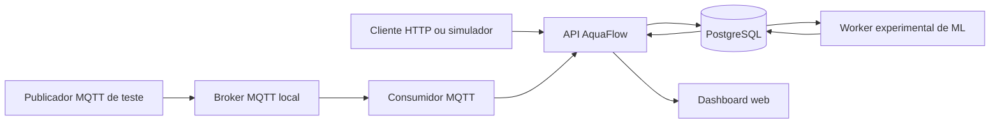

# AquaFlow

**AquaFlow é um protótipo acadêmico de monitoramento do consumo de água.** Ele integra uma aplicação web, uma API, PostgreSQL, ingestão de telemetria por HTTP e MQTT, monitoramento por regras e um experimento de machine learning.

O protótipo pode ser demonstrado com o histórico carregado pelo Compose ou com um ESP32 físico. A demonstração e o treinamento usam uma rotina doméstica simulada com vazões calibradas por medições de bancada. Os rótulos representam cenários simulados. O firmware publica por MQTT e a detecção em uma instalação residencial ainda precisa ser validada.

## Integrantes

| Nome | GitHub |
| --- | --- |
| Caio Almeida Amaral | [@Caio-Almeida-A](https://github.com/Caio-Almeida-A) |
| Celio Pereira Dias Junior | [@CelioJr12](https://github.com/CelioJr12) |
| Ester de Araujo Carvalho Menezes | [@ester-acm](https://github.com/ester-acm) |
| Guilherme Vinícius Rangel Silva | [@GuilhermeRangel1](https://github.com/GuilhermeRangel1) |
| João Pedro Moraes Barbosa | [@Joao-Vitor-Moraes](https://github.com/Joao-Vitor-Moraes) |
| Luana Lima Maynard de Arruda Falcão | [@lua-mf](https://github.com/lua-mf) |

## Navegação rápida

[Google Sites do projeto](https://sites.google.com/cesar.school/projetos6-gp14/in%C3%ADcio)

[Ideação e definição do problema](https://sites.google.com/cesar.school/projetos6-gp14/sr1/defini%C3%A7%C3%A3o-do-problema)

| Guia | O que você encontra |
| --- | --- |
| [Como executar](docs/demonstracao.md) | Inicialização com Docker Compose, conta de demonstração e comandos do fluxo principal. |
| [Arquitetura](docs/arquitetura.md) | Serviços, caminhos de dados e decisões da integração. |
| [Estado atual](docs/estado-do-projeto.md) | O que está implementado, o que é experimental e o que falta validar. |
| [Métricas e parâmetros](docs/metricas-e-parametros.md) | Limites, valores padrão e métricas usados no projeto. |
| [Avaliação do dataset híbrido](#resultado-de-referência) | Resultado atual e limites da avaliação. |
| [Histórico do experimento sintético](ml/docs/resultado-experimento.md) | Execução anterior à calibração de bancada. |
| [Dados e modelos](ml/README.md) | Série híbrida, pipeline, notebook, treinamento e inferência. |
| [Contrato MQTT](docs/contrato-mqtt.md) | Tópicos, autenticação e payload aceito pelo broker local. |
| [Especificação](especificacao-monitoramento-consumo-agua.md) | Requisitos e contratos de referência do produto e da API. |


## Visão geral

O AquaFlow recebe leituras de medidores, preserva os eventos recebidos, calcula consumo entre amostras compatíveis e mostra a evolução no dashboard. Regras determinísticas identificam comportamentos que merecem verificação. O classificador experimental de ML é avaliado em paralelo e não substitui essas regras.



Esse desenho representa a integração de desenvolvimento local. O detalhe dos serviços, contratos e limites atuais está em [Arquitetura](docs/arquitetura.md).

## O que o protótipo demonstra

- Conta local de Administração com propriedade e histórico da série híbrida.
- Cadastro e acompanhamento de medidores, ingestão HTTP e consulta de leituras.
- Ingestão MQTT encaminhada para a mesma API HTTP de validação e persistência.
- Cálculo de consumo entre leituras compatíveis, mantendo lacunas sem tratá-las como consumo zero.
- Alertas por regras explicáveis, com evidências e ações de reconhecimento, resolução e falso positivo.
- Experimento de classificação binária, execução de inferência integrada e alertas experimentais separados dos alertas por regras.
- Pipeline reprodutível com geração, análise e preparação dos dados, comparação de modelos, registro no MLflow e dashboard.

Essas funções mostram o funcionamento integrado do protótipo. Elas não comprovam medição física, desempenho de ML em residências nem prontidão para produção.

## Início rápido

### Requisitos

- Docker Desktop com Docker Compose v2.
- Portas locais `3000`, `5000`, `5432`, `8000` e `8080` disponíveis.
- Porta `1883` disponível para o broker MQTT local.
- Memória suficiente para a aplicação, o Airflow e o treinamento inicial. A geração do modelo pode levar alguns minutos.

Na raiz do repositório, inicie a solução completa:

```powershell
docker compose up --build
```

Na primeira execução, o Compose inicia PostgreSQL, API, dashboard, broker MQTT, consumidor MQTT, Airflow e MLflow. O serviço `demo-data` gera a série híbrida e a API grava o histórico na conta local. Se o modelo ainda não existir, o serviço `ml-trainer` prepara a mesma série, compara os modelos e registra o experimento. O worker `ml-inference` inicia depois do treinamento. Nas próximas execuções, o modelo salvo é reutilizado.

| Serviço | Endereço local |
| --- | --- |
| Dashboard AquaFlow | [http://localhost:3000](http://localhost:3000) |
| API e documentação OpenAPI | [http://localhost:8000/docs](http://localhost:8000/docs) |
| Prontidão da API | [http://localhost:8000/health/ready](http://localhost:8000/health/ready) |
| Experimentos MLflow | [http://localhost:5000](http://localhost:5000) |
| Interface Airflow | [http://localhost:8080](http://localhost:8080) |

O acesso ao Airflow e ao MLflow é local. O ESP32 acessa o broker pela porta `1883` no IP do computador que executa o Compose, na mesma rede. Use essa configuração de desenvolvimento em uma rede local de confiança.

### Conta local de Administração

```text
E-mail: admin@admin.com
Senha: admin123
Propriedade: Casa da Administração
```

Para mudar o e-mail ou a senha, copie `.env.example` para `.env` e altere `DEMO_USER_EMAIL` e `DEMO_USER_PASSWORD` antes de iniciar. Os valores padrão são destinados apenas à máquina local.

### O que você verá

Na conta local de Administração, selecione **Casa da Administração** para ver o **Medidor da série híbrida**. O Compose carrega esse histórico no PostgreSQL na primeira execução. A série usa vazões calibradas por medições do sensor de bancada, com rotina e datas simuladas. O seed preserva a telemetria física e remove os medidores antigos identificados como exemplos, junto com seus alertas e leituras.

### Demonstrar com o ESP32

1. Em **Medidores**, cadastre um medidor para a placa e configure o intervalo esperado de **30 segundos**.
2. Configure o serial, a chave do medidor e o IP do broker seguindo o [guia do firmware](firmware/aquaflow-esp32/README.md).
3. Ligue a placa, passe água pelo sensor e atualize a aba **Medidores** depois da próxima publicação. A API salva as leituras no PostgreSQL automaticamente.
4. Depois de uma janela completa de **cinco minutos** com dados suficientes, o worker avalia o consumo com o modelo já carregado. Se houver alerta experimental, ele aparece em **Acompanhamento** ao recarregar a página.

Na aba de acompanhamento, alertas de regras e análises experimentais de ML aparecem separados. Uma previsão positiva pode abrir um alerta experimental tratável; isso não muda os detectores por regras. Resultados insuficientes indicam que faltam dados válidos para calcular as features necessárias, e não que o modelo previu comportamento normal. Veja [como executar e demonstrar](docs/demonstracao.md) para os passos de MQTT, Airflow, logs e reinicialização.

## Como entram e são tratados os dados

### HTTP

Um dispositivo provisionado envia a leitura à API com seu número de série, um `event_id` estável, timestamp com fuso e volume acumulado, vazão instantânea ou ambos. A API valida a chave individual, verifica limites e timestamps, evita duplicar eventos reenviados e preserva a telemetria bruta. O consumo é calculado a partir de leituras válidas compatíveis.

### MQTT

O broker local recebe uma publicação no tópico do medidor. O consumidor valida a mensagem e encaminha a leitura para a API HTTP, que continua responsável por autenticação, validação, idempotência e armazenamento. O teste automatizado MQTT usa um banco isolado.

Para os tópicos, o corpo JSON e uma publicação de exemplo, consulte o [contrato MQTT](docs/contrato-mqtt.md).

### Regras de monitoramento

Os principais detectores atuais são fluxo contínuo acima do limite configurado, aumento persistente do consumo durante a janela noturna local e ausência de leituras por mais de dois intervalos esperados. As regras produzem explicações e evidências; seus padrões e condições estão em [Métricas e parâmetros](docs/metricas-e-parametros.md).

O AquaFlow sinaliza comportamentos que merecem verificação. Não confirma nem localiza fisicamente um vazamento.

## Experimento de machine learning

O primeiro modelo é um classificador binário por leitura válida. O gerador cria períodos normais, fluxo contínuo, consumo noturno e lacunas; `anomaly_label` marca os cenários artificiais. As features representam vazão, delta do volume acumulado, duração do intervalo e horário cíclico local. Identificadores, dados de bateria/sinal e rótulos não são entradas do modelo.

O treinamento padrão usa 16 dias simulados com vazões calibradas em bancada, partição cronológica de 8/4/4 dias, validação cruzada temporal e comparação entre KNN, Árvore de Decisão, Random Forest e um baseline de prevalência. A seleção considera average precision na validação temporal e num perfil simulado com rotina alterada. Um perfil de estresse fica separado para avaliação posterior.

### Resultado de referência

O Dummy Classifier usa a prevalência do treino como referência para medir o ganho de modelos que usam as features. O MLflow guarda cada combinação da busca aleatória, suas métricas por divisão temporal e a combinação vencedora de cada modelo. A seleção final usa a média da AP na validação padrão e na validação com rotina alterada. O teste cronológico e o perfil de estresse ficam reservados para avaliação posterior.

Na execução com a série híbrida, o Random Forest foi selecionado com AP média de **0,594** na validação. No teste cronológico, a AP foi **0,999**. No perfil de estresse, a AP caiu para **0,502** e o recall foi **5,6%** no limiar de 0,5. As métricas descrevem o desempenho em perfis simulados calibrados em bancada. O relatório da execução local está em `data/ml/training-bench-v2/training_report.md`.

O relatório mostra a diferença entre treino e validação e a variação da AP entre divisões temporais. A queda no perfil de estresse indica sensibilidade a mudanças de rotina simuladas. A generalização para residências depende de validação em campo.

### Airflow, treinamento e notebook

- **Airflow:** acione o DAG manualmente para gerar, analisar e preparar a série híbrida, treinar um modelo candidato com esses arquivos e registrar as execuções no MLflow. As saídas ficam em `data/ml/airflow/<execução>/`, separadas do modelo em uso.
- **Treinamento do Compose:** executa automaticamente quando o artefato não existe ou pode ser forçado com o comando descrito em [Dados e modelos](ml/README.md).
- **Notebook:** documenta a exploração e o preparo e gera gráficos de avaliação a partir do modelo treinado. Não substitui o pipeline nem envia seus gráficos ao dashboard.
- **Inferência na aplicação:** o worker avalia leituras persistidas com dados suficientes e registra a versão do modelo. As regras permanecem ativas se o worker falhar.

Para os valores de configuração, métricas, unidades e limitações do experimento, consulte [Métricas e parâmetros](docs/metricas-e-parametros.md). O [estado atual do projeto](docs/estado-do-projeto.md) explica o que será necessário para migrar de dados simulados para telemetria real.

## Configurações locais

As configurações opcionais ficam em `.env`. Use `.env.example` como modelo; mantenha o arquivo `.env` local e não compartilhe credenciais.

| Variável | Uso |
| --- | --- |
| `POSTGRES_PASSWORD` | Senha do banco local. |
| `JWT_SECRET` | Segredo usado para tokens de acesso; gere um valor próprio fora da demonstração local. |
| `DEMO_MODE` | Habilita a preparação da conta demonstrativa no ambiente local. |
| `DEMO_USER_EMAIL`, `DEMO_USER_PASSWORD` | Credenciais da conta demo. |
| `MQTT_PUBLISH_PASSWORD`, `MQTT_INGEST_PASSWORD` | Credenciais locais do publicador e do consumidor MQTT. |
| `ML_POLL_SECONDS` | Intervalo de consulta do worker de inferência, em segundos. |

Os padrões e os limites configuráveis são para desenvolvimento. Para não expor a instância, mantenha-a no computador local; os serviços não foram preparados como configuração de produção.

## Organização do repositório

```text
backend/          API FastAPI, domínio, persistência, migrations e testes
frontend/         Interface Next.js, React, TypeScript e Recharts
ml/               Dados sintéticos, preparação, modelos, inferência e notebook
firmware/         Firmware ESP32, guia de montagem e contrato de telemetria
docs/             Arquitetura, parâmetros, estado, demonstração e contratos
infrastructure/   Configuração local do broker MQTT
docker-compose.yml
```

## Desenvolvimento e verificações

O modo recomendado para executar a solução integrada é Docker Compose. Para desenvolvimento local, veja as dependências em `backend/pyproject.toml` e `frontend/package.json` e disponibilize um PostgreSQL compatível.

Para verificar a API:

```powershell
cd backend
python -m pytest -q
ruff check app tests migrations
mypy app
```

Para verificar o frontend:

```powershell
cd frontend
npm ci
npm run lint
npm run typecheck
npm test
npm run build
```

Para executar a suíte HTTP com PostgreSQL isolado pelo Compose:

```powershell
docker compose -f docker-compose.yml -f docker-compose.test.yml --profile test run --build --rm tests
```

Para o ambiente do notebook e os comandos completos do pipeline, consulte [Dados e modelos](ml/README.md). As verificações e as métricas de referência devem sempre ser interpretadas conforme seus dados e limitações.

## Limites e próximos passos

- O firmware ESP32 publica por MQTT. Confira a calibração do sensor e a conexão da placa na rede usada na apresentação.
- A ingestão MQTT foi exercitada com um publicador de teste na rede local do Compose; não há conexão física validada nem TLS para um dispositivo externo.
- O histórico da demonstração e o treino partem da mesma série híbrida. A demonstração desloca as datas para perto do dia de instalação e preserva as lacunas e as medições da série.
- O classificador foi avaliado somente com cenários artificiais. Dados reais precisarão de coleta, verificação de qualidade, decisão de rotulagem e teste temporal independente.
- Airflow, MLflow, credenciais e serviços do Compose são configurados para apresentação local, não para produção.

Veja [Estado atual do projeto](docs/estado-do-projeto.md) para as limitações e o [guia do firmware ESP32](firmware/aquaflow-esp32/README.md) para montagem e configuração.
