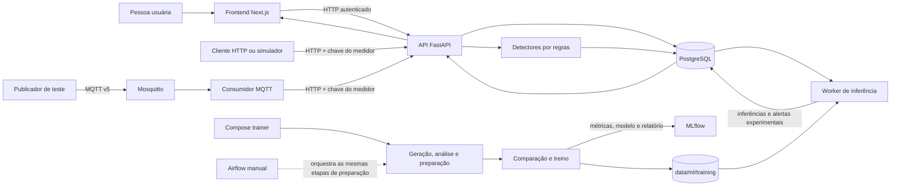
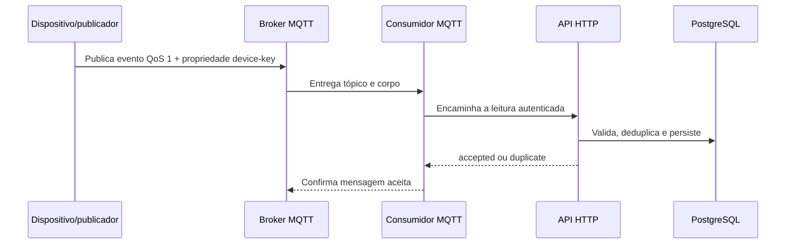

# Arquitetura do AquaFlow

O AquaFlow é um protótipo integrado para demonstrar aquisição de telemetria, armazenamento, cálculo de consumo, monitoramento por regras, avaliação experimental de ML e apresentação no dashboard. O fluxo pode ser executado localmente com Docker Compose. Os dados de demonstração e de treinamento são simulados; não há um ESP32 físico conectado nem validação do modelo com consumo residencial real.

## Visão geral

O backend é um monólito modular: autenticação, propriedades, medidores, ingestão, consumo e alertas ficam na mesma API e no mesmo banco. MQTT, treinamento, inferência e interface são processos separados no Compose, mas não formam uma arquitetura de microsserviços de produção.

## Decisões da solução

- **HTTP como fronteira de ingestão:** MQTT e envio HTTP convergem para a mesma API, que centraliza validação, autenticação do medidor, idempotência e persistência. Isso reduz a duplicação de regras entre transportes.
- **PostgreSQL como fonte persistente:** leituras brutas, estados dos alertas e inferências ficam no banco relacional, permitindo rastrear de onde vieram agregações e resultados.
- **Regras independentes do ML:** as regras determinísticas continuam ativas quando o artefato ou o worker de ML está indisponível. O classificador continua experimental e suas previsões não apagam nem substituem alertas de regras.
- **Dados gerados para o primeiro ciclo:** geradores reproduzíveis permitem exercitar preparação, treinamento e interface sem aguardar hardware; em contrapartida, não sustentam alegações de desempenho no mundo real.
- **Airflow manual e treinamento no Compose:** o DAG demonstra orquestração de geração, análise e preparação; o serviço de treinamento do Compose mantém o caminho de inicialização completa reproduzível sem depender de disparar o DAG pela interface.

Os valores usados por essas decisões e os resultados de referência do classificador estão em [Métricas e parâmetros](metricas-e-parametros.md) e [Resultado do experimento](../ml/docs/resultado-experimento.md).

## Caminho de uma leitura

### Ingestão HTTP

Um dispositivo autenticado envia uma leitura para a API com o número de série, `event_id`, instante e pelo menos vazão ou volume acumulado. A API verifica a credencial individual do medidor, valida o contrato, persiste o evento e impede que uma repetição do mesmo `event_id` duplique a leitura. Os detectores por regras avaliam os dados compatíveis e o dashboard consulta os resultados pela API.

### Ingestão MQTT

O broker Mosquitto recebe uma mensagem MQTT v5 no tópico descrito em [Contrato MQTT](contrato-mqtt.md). A chave do medidor segue como propriedade MQTT, fora do corpo JSON. O consumidor valida o tópico e encaminha o corpo para a mesma rota HTTP usada na ingestão direta. Assim, MQTT altera o transporte de entrada, mas não cria um segundo caminho de validação ou persistência.

Na configuração Compose local, o broker não publica sua porta no computador. A publicação de teste é feita pelo serviço `mqtt-publisher`. O fluxo foi preparado para integrar um dispositivo, mas não comprova conectividade de um ESP32 físico.

## Consumo e alertas

O sistema preserva as leituras brutas e calcula consumo apenas entre leituras compatíveis. O volume acumulado pode ser convertido em delta; vazão instantânea também pode alimentar as séries. Timezone, intervalos inválidos, resets e lacunas são tratados explicitamente. Um intervalo sem leitura não é contabilizado como consumo zero.

Os detectores por regras produzem alertas explicáveis com período e evidências. Alertas podem ser reconhecidos, resolvidos ou marcados como falso positivo. As previsões de ML são armazenadas separadamente; uma previsão positiva também pode abrir um alerta experimental tratável. A inferência não substitui nem desativa as regras.

## Preparação e treinamento de ML

O pipeline de treinamento atual usa dados sintéticos gerados por `ml/generate_mock_data.py`. Esses registros têm rótulos definidos pelo simulador para cenários como fluxo contínuo, consumo noturno e leituras ausentes. Os rótulos não são observações de vazamentos reais.

No primeiro `docker compose up --build`, se não houver `best_model.joblib` e `metrics.json` em `data/ml/training/`, os serviços executam:

1. Geração determinística de 16 dias simulados, em intervalos esperados de cinco minutos.
2. Validação de estrutura, timestamps, identificadores, valores e rótulos.
3. Preparação das features e separação de metadados e rótulos.
4. Comparação de um baseline de prevalência, regressão logística, Random Forest e HistGradientBoosting.
5. Registro de parâmetros, métricas e artefatos no MLflow.
6. Inicialização do worker, que avalia as leituras armazenadas ainda não processadas.

O modelo usa vazão, variação do volume acumulado, duração do intervalo e hora/dia da semana codificados ciclicamente no fuso da propriedade. Identificadores, serial, timestamp bruto, bateria, sinal, firmware e rótulos não entram como features. As transformações compartilhadas ficam em `ml/feature_transforms.py`.

O notebook [`ml/notebooks/01_exploracao_e_avaliacao.ipynb`](../ml/notebooks/01_exploracao_e_avaliacao.ipynb) documenta a exploração e a preparação e cria gráficos de avaliação. Ele não substitui o treinamento automatizado. O DAG do Airflow também é acionado manualmente e cobre geração, análise e preparação; o treinamento automático do Compose executa os mesmos scripts diretamente, sem depender de uma execução do DAG.

## Serviços locais

| Serviço Compose | Papel |
| --- | --- |
| `db` | PostgreSQL para contas, propriedades, dispositivos, telemetria, alertas e inferências. |
| `api` | API FastAPI; aplica migrations e prepara a conta demonstrativa na inicialização. |
| `frontend` | Interface Next.js servida em `http://localhost:3000`. |
| `mqtt` | Broker Mosquitto da rede Compose. |
| `mqtt-ingestor` | Encaminha mensagens MQTT aceitas para a API HTTP. |
| `mlflow` | Interface e armazenamento local de experimentos em `http://localhost:5000`. |
| `ml-trainer` | Tarefa de geração, preparação e treinamento; encerra quando termina. |
| `ml-inference` | Worker que avalia telemetria persistida após o artefato estar disponível. |
| `ml-airflow` | Airflow standalone local para executar o DAG educacional manualmente em `http://localhost:8080`. |
| `mqtt-publisher`, `ml-data-generator` | Ferramentas sob demanda, não serviços permanentes da demonstração. |

O comando principal é `docker compose up --build`. O banco, o estado do broker, o estado do Airflow, os dados de ML e os experimentos MLflow persistem em volumes ou diretórios locais. `docker compose down` encerra os serviços sem apagar esses dados. `docker compose down --volumes` apaga também os volumes nomeados, inclusive o banco local.

## Limites do ambiente

As portas do dashboard e da API são publicadas pelo Compose para desenvolvimento local. Airflow e MLflow ficam vinculados ao loopback; o broker não publica porta no host. Mesmo assim, a configuração inteira é local e usa credenciais de desenvolvimento. Não exponha o Compose à internet nem trate as credenciais demonstrativas como credenciais de produção. Consulte [Estado atual e limitações](estado-do-projeto.md) e [guia de execução](demonstracao.md).
